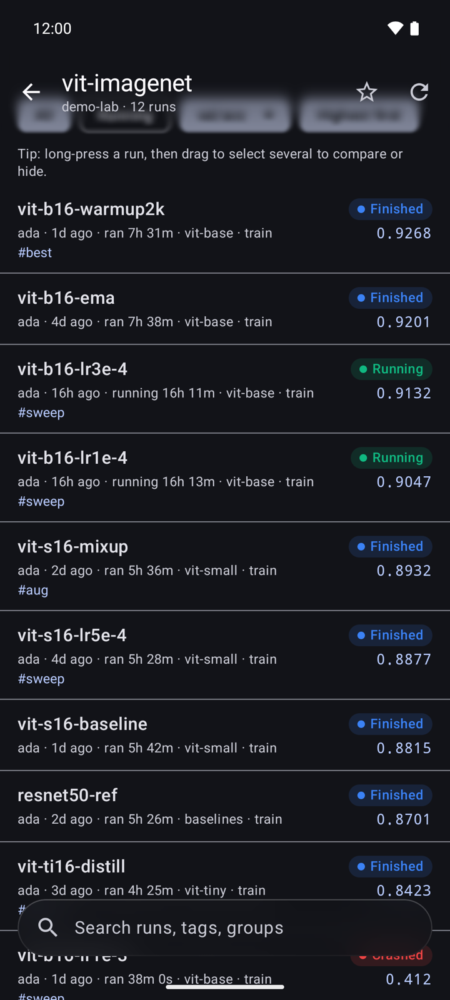
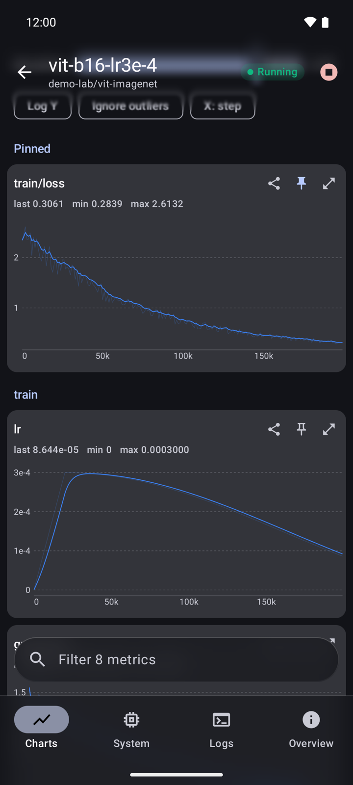
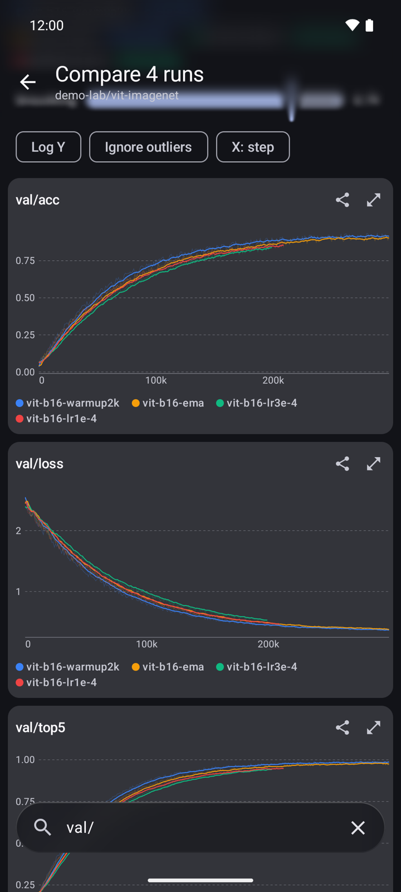
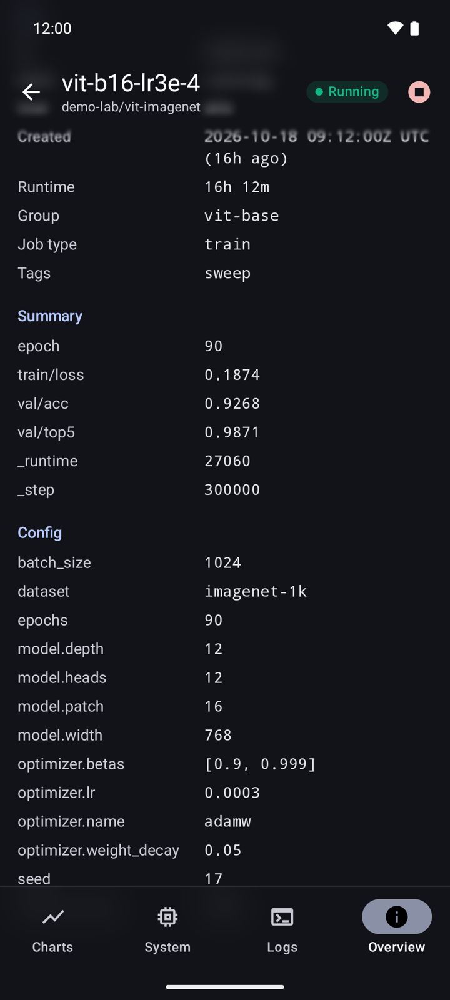

# RunWatch

An unofficial Android client for [Weights & Biases](https://wandb.ai). Use it to watch your training runs from your phone.

<p align="center">
  
  
  
  
</p>

<p align="center"><sub>Runs · Charts · Compare · Overview — demo data, with the frosted glass bars over scrolled content</sub></p>

The official W&B mobile app is iOS-only. RunWatch covers the core monitoring features for Android:

- **Projects and runs.** Sign in with your W&B API key, switch between your personal entity and your teams, and browse projects and runs with their live state.
- **Live metric charts.** Every numeric key you log with `wandb.log()` gets a chart, with EMA smoothing (the same as the web UI), a log Y-axis, and touch-to-read values. While a run is active, charts refresh every 15 s.
- **System metrics.** GPU utilization, memory, temperature and power, plus CPU, RAM, disk and network, grouped one chart per metric with a line per GPU.
- **Console logs.** The last 1,000 lines with ANSI colors, refreshing every 5 s while the run is live.
- **Chart tools.** Last / min / max on every chart, "ignore outliers" so one spike doesn't flatten a curve, step or wall-clock X axis, pinned metrics, and a full-screen view with pinch-to-zoom.
- **Runs list.** Search by name, tag, group or user, and show any summary metric as a column to sort runs by it.
- **Run overview.** Run details, final summary values and the full training config (nested settings flattened, e.g. `optimizer.lr`).
- **Compare runs.** Long-press a run and drag to select several (or tap to add more), then overlay up to 8 runs on every metric with one color per run.
- **Share charts.** Export any chart as a PNG with its title, run, legend and settings, and send it through the share sheet.
- **Hide runs.** Select runs and hide them from the list on this phone (nothing changes on W&B). Restore them from the project's Hidden filter, with Undo, or all at once in Settings.
- **Glass UI.** Frosted, translucent bars with content scrolling underneath (Android 12+; switch off in Settings on slower phones). Search bars float at the bottom by default.
- **Stop runs.** This sends the same graceful stop signal as the Stop button in the web UI.
- **Failure alerts.** Star a project and RunWatch checks it about every 15 minutes in the background. You get a notification when a running run crashes or fails, and optionally when one finishes.

## Install

Download `runwatch-<version>.apk` from the [latest release](https://github.com/YinlongDai/WANDB-Android/releases/latest) on your phone, open it, and allow installs from that source when Android asks.

You only do this once. Every push to `main` publishes a new release, and RunWatch offers it in the app ("Update available"), or from the **Check** button next to the version in Settings.

## Build locally

You need Android Studio (or JDK 17 plus the Android SDK). Then run:

```bash
./gradlew assembleDebug        # app/build/outputs/apk/debug/app-debug.apk
./gradlew testDebugUnitTest    # JVM unit tests for parsing and chart math
./gradlew recordPaparazziDebug  # re-render the screenshot tests in app/src/test/snapshots/images
```

## How it works

RunWatch talks directly to the W&B GraphQL API at `https://api.wandb.ai/graphql`, which is the same endpoint the `wandb` Python SDK uses. It authenticates with HTTP Basic auth, user `api` and your API key. Your key is stored in app-private storage and is excluded from backups. For Dedicated Cloud or self-hosted servers, change the API host on the sign-in screen.

| Path | Contents |
|------|----------|
| `data/WandbApi.kt` | GraphQL queries: viewer, projects, runs, sampledHistory, events, logLines, stopRun |
| `data/Parsers.kt` | Pure JSON → model parsing (unit-tested) |
| `data/ChartMath.kt` | Smoothing, min/max downsampling, axis ticks |
| `ui/` | Jetpack Compose screens and a Canvas line chart |
| `alerts/RunAlertWorker.kt` | WorkManager job behind the failure alerts |

## Notes

- Android limits background checks to about every 15 minutes, so alerts are not instant.
- Releases are signed in CI with a fixed key kept in the repository's secrets, so each update installs over the previous version. Forks need their own key (`RELEASE_KEYSTORE_BASE64`, `RELEASE_KEYSTORE_PASSWORD`, `RELEASE_KEY_ALIAS`).
- RunWatch is not affiliated with Weights & Biases or CoreWeave.
